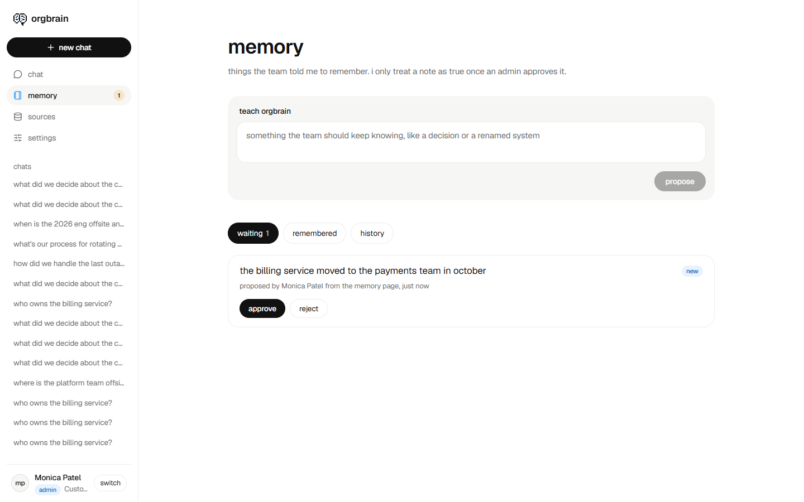
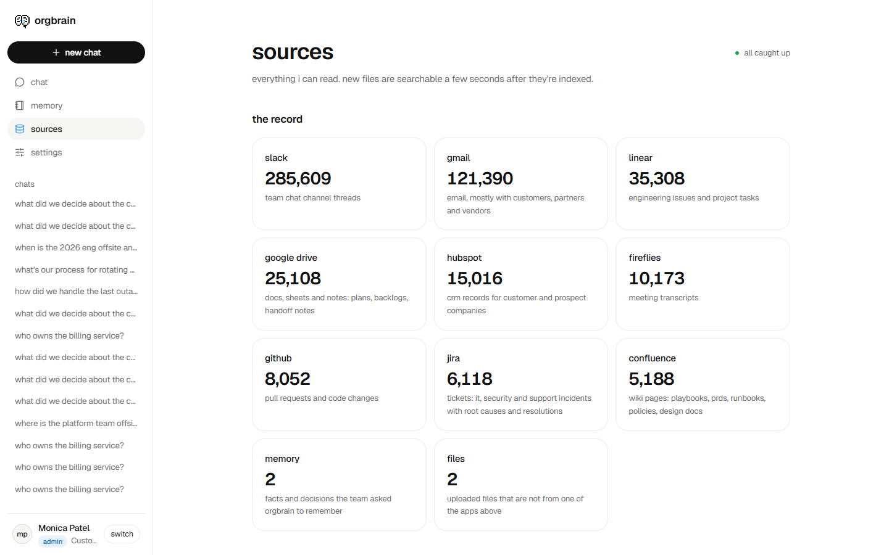

# orgbrain

An open-source company brain you run yourself: it reads your team's chat, email, tickets and docs, answers with
citations, remembers what the team approves, and joins Slack.


<p>
  
  
</p>

The GIF is sped up; a real answer takes about a minute on a laptop GPU.

## Quickstart

```
git clone https://github.com/abhilashHQ/OrgBrain.git orgbrain && cd orgbrain
cp .env.example .env
docker compose up -d
docker compose run --rm api codex login --device-auth
docker compose run --rm api orgbrain demo
```

Then open http://localhost:3000 and sign in as anyone at Redwood Inference, the demo company. The login step connects
Codex to your ChatGPT plan; skip it if you use an API key instead.

You need Docker with about 6 GB of RAM (the whole stack measured 5.1 GB idle, 5.2 GB answering), about 40 GB of free
disk, and an NVIDIA GPU with 3 GB of free VRAM. The demo index is a 9.1 GB download.

[docs/quickstart.md](docs/quickstart.md) has the details: what each step does, how fast it is,
checking the stack with `orgbrain status`, and what to do when something doesn't come up.

## What it does

- **Chat with cited answers.** Every claim links to the message, ticket or doc it came from, and the document opens next
  to the answer. You see each search and read as it happens.
- **Memory with an approval queue.** Tell it something worth keeping and it proposes a note. An admin approves or
  rejects it on the Memory page or with a Slack button. Approved notes are searchable by everyone and say where they
  came from.
- **Connectors.** A folder of `.md`, `.txt`, `.pdf` and `.docx` files (`orgbrain connect folder`), uploads on the Sources
  page, and live Slack sync. [docs/connectors.md](docs/connectors.md)
- **A Slack bot.** Mentions and DMs, a status message it edits while it searches, memory buttons, and replies in
  channels on its own when it has something to add, under an hourly budget. [docs/slack.md](docs/slack.md)
- **An MCP server** with `search`, `lookup`, `read_doc`, `find_people` and `propose_memory`, so other agents can use the
  same index.
- **A people directory** built from the corpus (email headers, meeting attendees, Slack speakers, CRM contacts), so it can
  say who to talk to.

The demo company, Redwood Inference, is the [EnterpriseRAG-Bench](https://huggingface.co/datasets/onyx-dot-app/EnterpriseRAG-Bench)
corpus: 511,962 documents from Slack, Gmail, Linear, Google Drive, HubSpot, Fireflies, GitHub, Jira and Confluence.
`orgbrain demo` downloads the prebuilt index from
[Hugging Face](https://huggingface.co/datasets/abhilash242299/orgbrain-redwood-index) instead of embedding it all again.

## Bring your own model

- **Codex CLI on a ChatGPT plan.** The default, and the one everything above was tested with. You log in once inside
  the stack (the quickstart's `codex login --device-auth`); the login stays in its own Docker volume.
- **Any OpenAI-compatible API** (OpenAI, OpenRouter, vLLM, Ollama, anything with chat completions and tool calls). Unit
  tested with a scripted client, not yet run end to end against a real provider.
- **Claude Code and Gemini CLI** are untested.

Switch between them on the Settings page. [docs/models.md](docs/models.md)

Using a personal plan to run a bot for a team is between you and your provider's terms. Check them first.

## Search quality

Measured on the 150 dev questions of EnterpriseRAG-Bench, every answer judged by `gpt-oss-120b` on Bedrock with the
benchmark's own harness:

| | combined score | source |
|---|---|---|
| orgbrain end to end, Codex `gpt-6.2-sol`, medium effort | 81.8 | `runs/orgbrain_sol_medium` |
| orgbrain, current constitution, same model | 80.3 | `runs/orgbrain_sol_v3` |
| PipesHub's published leaderboard answers, same judge | 91.5 | `runs/lb_pipeshub` |

orgbrain trails the best leaderboard entry by about 10 points. The search alone (hybrid dense and BM25 in Qdrant,
reranked at depth 20) finds a labelled document in its top 10 for 73.4% of the 141 dev questions that have labelled
documents (recall@10, `runs/rerank_depth.log`). The `runs/` folder isn't in the repo; the research behind these
numbers, including a held-out test run, is in [docs/benchmark.md](docs/benchmark.md).

## Architecture

```
web app | slack bot | any mcp client
        -> api (fastapi, streams steps over sse)
        -> agent runtime (codex cli, or an openai-compatible tool loop)
        -> mcp search server -> qdrant (dense + bm25) -> reranker; sqlite docs and phrase index

connector, upload or approved memory -> postgres row + outbox -> redis stream -> worker -> qdrant
```

Seven containers: qdrant, postgres, redis, models (the embedder and reranker, the only one with torch), search, api and
worker, plus the web app and the optional Slack bot. [docs/architecture.md](docs/architecture.md)

## Status and limits

This is v1.

- One workspace. Sign-in is a "sign in as" picker of Redwood employees, with no real auth, so don't expose it beyond
  your machine.
- One question at a time across the whole workspace; anyone asking while orgbrain is answering gets "busy" and asks again.
- English only.
- Tested on Windows 11 with Docker Desktop and an RTX 3050 laptop GPU (6 GB).

## License

MIT, see [LICENSE](LICENSE).

## Notice

- The Redwood Inference corpus comes from [EnterpriseRAG-Bench](https://github.com/onyx-dot-app/EnterpriseRAG-Bench) by
  DanswerAI (Onyx), MIT licensed. It's benchmark data and should never appear in training corpora.
- Search uses [Qwen3-Embedding-0.6B](https://huggingface.co/Qwen/Qwen3-Embedding-0.6B) and
  [Qwen3-Reranker-0.6B](https://huggingface.co/Qwen/Qwen3-Reranker-0.6B), both licensed Apache 2.0 according to their
  model cards.
